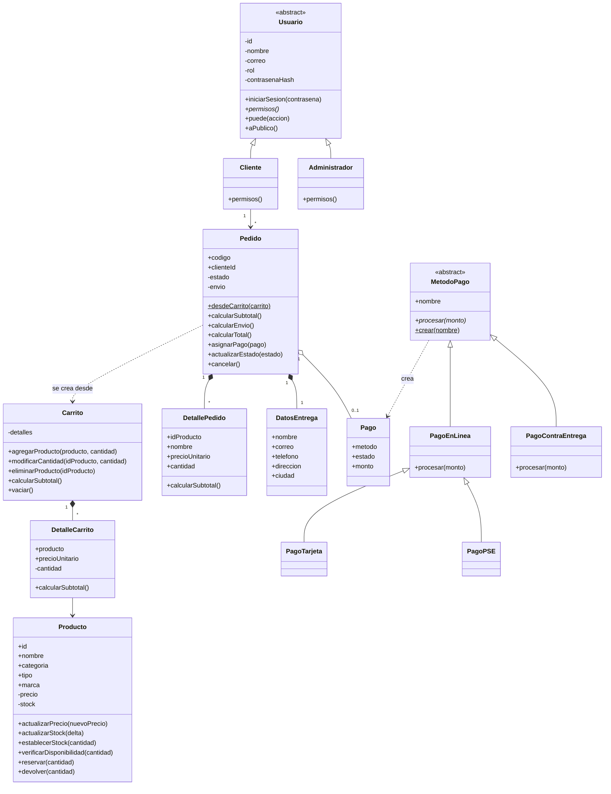

# Mashe: aplicación de POO y correspondencia con los requisitos

## 1. Arquitectura por capas

```
Navegador (frontend) ──HTTP──▶ Rutas ─▶ Controladores ─▶ Servicios ─▶ Dominio (clases)
                                                              │
                                                              ▼
                                                        Repositorios ─▶ Modelos Mongoose ─▶ MongoDB
```

| Capa | Carpeta | Responsabilidad |
|---|---|---|
| Dominio | `src/domain/` | Clases con atributos, métodos y **todas las reglas de negocio** |
| Servicios | `src/services/` | Orquestan un caso de uso (comprar, registrar...) usando clases y repositorios |
| Repositorios | `src/repositories/` | Único lugar que habla con Mongoose; convierten documentos ↔ objetos del dominio |
| Modelos Mongoose | `src/models/` | Solo definen cómo se guarda en MongoDB (esquemas) |
| Controladores | `src/controllers/` | Traducen HTTP ↔ servicio. **Sin reglas de negocio** |
| Rutas y middlewares | `src/routes/`, `src/middlewares/` | Qué URL llama a qué controlador y quién puede entrar |
| Ensamblaje | `src/container.js` | Crea los objetos y los conecta (inyección de dependencias) |

## 2. Principios de POO y dónde verlos

**Abstracción**
- `Usuario` y `MetodoPago` son clases abstractas: definen *qué* hace un tipo de objeto sin decir *cómo*; no se pueden instanciar (`new Usuario()` lanza error).
- Los métodos `permisos()` y `procesar()` están declarados en la base y cada subclase los implementa.

**Encapsulamiento**
- `Producto.js`: `#precio` y `#stock` son privados. `producto.stock = -5` lanza `TypeError`; solo se cambian con `actualizarStock()`, `reservar()`, `devolver()` y `establecerStock()`, que validan que el stock nunca sea negativo.
- `Usuario.js`: `#contrasenaHash` es privado; el hash solo sale por `datosParaGuardar()` y nunca por `aPublico()`.
- `Pedido.js`: `#estado` y `#envio` privados; el estado solo cambia con `actualizarEstado()` o `cancelar()`, que aplican la tabla de transiciones.
- `Carrito.js`: la colección de detalles es privada; se manipula con `agregarProducto()`, `modificarCantidad()`, etc.

**Herencia**
- `Usuario` ← `Cliente`, `Administrador`
- `MetodoPago` ← `PagoEnLinea` ← `PagoTarjeta`, `PagoPSE`; y `MetodoPago` ← `PagoContraEntrega`
- `ErrorDeNegocio` ← `ErrorValidacion`, `ErrorNoAutenticado`, `ErrorSinPermiso`, `ErrorNoEncontrado`, `ErrorConflicto` ← `ErrorStock`, `ErrorPagoRechazado`

**Polimorfismo**
- `usuario.puede("gestionar_productos")` se llama igual, pero un `Cliente` responde `false` y un `Administrador` `true` (cada uno sobrescribe `permisos()`). El middleware `requirePermiso` lo usa sin saber qué clase es.
- `metodoPago.procesar(monto)` se llama igual en `PagoTarjeta`, `PagoPSE` y `PagoContraEntrega`: los dos primeros aprueban al instante; contra entrega queda *pendiente*. `PedidoService` no tiene ningún `if` por método de pago.

**Composición y otros patrones**
- `Carrito` *tiene* `DetalleCarrito`; `Pedido` *tiene* `DetallePedido`, `DatosEntrega` y `Pago`.
- `Pedido.desdeCarrito()` construye el pedido a partir del carrito (igual que en el diseño base).
- Fábricas: `crearUsuario(rol)` y `MetodoPago.crear(nombre)`.
- Repositorio y servicio con dependencias por constructor: por eso `PedidoService` se prueba con repositorios en memoria, sin MongoDB.

## 3. Dónde vive cada regla de negocio

| Regla | Clase |
|---|---|
| El stock nunca es negativo | `Producto` |
| No agregar más unidades que el stock | `Carrito` / `Producto.verificarDisponibilidad()` |
| Envío $9.000, gratis desde $150.000 | `Pedido` |
| El precio del pedido es el del momento de la compra | `DetalleCarrito` / `DetallePedido` |
| Estados válidos del pedido y cancelación | `Pedido` |
| Contraseña de 6 a 50 caracteres y encriptada | `Usuario` |
| Cliente y administrador tienen permisos distintos | `Cliente`, `Administrador` |
| Resultado del pago según el método | `PagoTarjeta`, `PagoPSE`, `PagoContraEntrega` |
| Descontar el inventario sin dejarlo negativo si compran dos a la vez | `ProductoRepository.reservarStock()` (condición atómica en MongoDB) |
| Devolver stock si el pago falla o se cancela | `PedidoService` |

## 4. Clases ↔ modelos Mongoose ↔ colecciones

| Clase del dominio | Modelo / colección | Notas |
|---|---|---|
| `Usuario`, `Cliente`, `Administrador` | `User` / `users` | El campo `role` decide la clase al leer (`crearUsuario`) |
| `Producto` | `Product` / `products` | `specs` va embebido |
| `Carrito`, `DetalleCarrito` | *(sin colección)* | El carrito vive en el navegador; al comprar se reconstruye en el servidor y se valida |
| `Pedido`, `DetallePedido` | `Order` / `orders` | Los detalles van **embebidos** en `items` (con nombre y precio del momento) |
| `Pago`, `MetodoPago` | `Order.payment` | `{ method, status }` embebido en el pedido |
| `DatosEntrega` | `Order.customer` | Embebido en el pedido |
| `Categoria` | *(pendiente)* | Hoy las categorías son una lista fija en `Producto` (`CATEGORIAS`) |

Relaciones en MongoDB: `orders.user` referencia a `users._id` (nulo si compró como invitado) y cada ítem de `orders.items` guarda `productId`, que corresponde a `products.id`.

## 5. Requisitos del documento ↔ implementación

| Req. | Función | Clase / servicio | Endpoint |
|---|---|---|---|
| R1 | Registrar usuario | `UsuarioService.registrar`, `Cliente` | `POST /users/register` |
| R2 | Iniciar sesión | `UsuarioService.iniciarSesion`, `Usuario.iniciarSesion` | `POST /users/login` |
| R3 | Consultar catálogo | `ProductoService.listar` | `GET /products` |
| R4 | Buscar productos | Filtro y búsqueda en el frontend (`app.js`) sobre el catálogo | — |
| R5 | Detalle de producto | `ProductoService.obtener` | `GET /products/:id` |
| R6 | Gestionar carrito | `Carrito`, `DetalleCarrito` (reconstruido y validado al comprar) | — |
| R7 | Generar pedido | `PedidoService.crearPedido`, `Pedido.desdeCarrito` | `POST /orders` |
| R8 | Realizar pago (simulado) | `MetodoPago` y subclases | `POST /orders` (campo `pay`) |
| R9 | Historial de pedidos | `PedidoService.misPedidos` | `GET /orders/mine` |
| R10 | Registrar producto | `ProductoService.crear`, `Producto` | `POST /products` (admin) |
| R11 | Modificar producto | `ProductoService.actualizar` | `PATCH /products/:id` (admin) |
| R12 | Gestionar categorías | *Pendiente* (lista fija en `Producto`) | — |
| R13 | Gestionar inventario | `Producto.actualizarStock/establecerStock`, `reservarStock` | `PATCH /products/:id` (admin) y automático al comprar o cancelar |
| R14 | Gestionar pedidos | `PedidoService.listarTodos/cambiarEstado` | `GET /orders`, `PATCH /orders/:code/status` (admin) |
| R15 | Control de acceso por rol | `Usuario.puede`, `requirePermiso` | middleware en las rutas |

## 6. Diagrama de clases (Mermaid)

Se puede pegar en https://mermaid.live para exportarlo como imagen.



## 7. Pruebas

`npm test` ejecuta 35 pruebas automáticas, sin necesidad de MongoDB:

- `src/test/dominio.test.js`: herencia y polimorfismo de usuarios y pagos, encapsulamiento del stock, carrito, envío, estados y cancelación del pedido.
- `src/test/pedido.service.test.js`: flujo completo de compra con repositorios en memoria: descuento de inventario, total, pago aprobado o rechazado, falta de stock, cancelación con devolución de stock, cambio de estados por el administrador y aislamiento entre clientes.

### Prueba de integración manual (evidencia con capturas)

1. `POST /users/register` → 201 con token. Repetir con el mismo correo → 409.
2. `POST /users/login` con clave incorrecta → 401; con la correcta → 200 con token.
3. `GET /products` → 24 productos. Anotar el stock del producto 1.
4. `POST /orders` (con token) con `items: [{ "id": 1, "qty": 2 }]`, datos de entrega y `pay: "tarjeta"` → 201 y estado `pagado`.
5. `GET /products/1` → el stock bajó 2. En Atlas, la colección `orders` tiene el pedido.
6. `GET /orders/mine` → aparece el pedido.
7. `POST /orders` con `"simulateReject": true` → 402 y el stock no cambia.
8. `POST /orders` con una cantidad mayor al stock → 409.
9. `PATCH /orders/:code/cancel` → 200 y el stock se devuelve.
10. Con un token de cliente, `POST /products` → 403. Con un administrador → 201.
